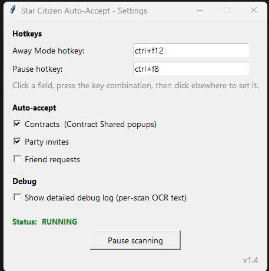

# Star Citizen Auto-Accept

A lightweight Windows helper that watches your screen while you play **Star
Citizen** and automatically accepts mission/contract popups for you.

It works entirely by *reading the screen* — it takes a small screenshot of the
top-center of your monitor every couple of seconds, runs OCR (text
recognition) on it, and when it sees a popup you've chosen to auto-accept it
presses the `[` key. It does **not** read or modify the game's memory or
files.

## Features

- Auto-accepts **Contract Shared** popups (and optionally **party invites** and
  **friend requests**).
- **Away Mode** — taps the Up arrow every few minutes so the game doesn't kick
  you for being idle.
- **System tray icon** with a right-click menu (settings, pause, show/hide the
  log window, exit).
- **Settings window** for configuring hotkeys and which popups to accept —
  saved to `settings.json`.
- **Debug snapshot** hotkey that saves exactly what the script is capturing,
  for troubleshooting.

## Requirements

| Requirement | Notes |
|---|---|
| Windows 10 / 11 | The script uses Windows-only input and screen APIs. |
| Star Citizen in **Borderless** window mode | **Important** — screen capture cannot see a game running in exclusive *Fullscreen*. Set this in-game under *Settings → Graphics → Window Mode → Borderless*. |
| [Python 3.8+](https://www.python.org/downloads/) | Tick **"Add python.exe to PATH"** during install. |
| [Tesseract OCR](https://github.com/UB-Mannheim/tesseract/wiki) | A separate program that does the text recognition. Install with default settings. |
| Python packages | `mss`, `pillow`, `pytesseract`, `pydirectinput`, `keyboard`, `pystray` — installed automatically by `install_requirements.bat`. |

## Installation

1. **Install Python** from [python.org](https://www.python.org/downloads/).
   During setup, tick **"Add python.exe to PATH"**.

2. **Install Tesseract OCR** from the
   [UB-Mannheim builds](https://github.com/UB-Mannheim/tesseract/wiki).
   Download the file named like `tesseract-ocr-w64-setup-5.x.x.exe` and click
   through with the default settings. The script searches the common install
   locations automatically.

3. **Download this repository** (green *Code* button → *Download ZIP*, or
   `git clone`) and unzip it to a folder of your choice.

4. **Install the Python packages** — double-click **`install_requirements.bat`**.
   It runs `pip` for you. You should see *"Successfully installed"* near the
   end.

5. **Set Star Citizen to Borderless** window mode (see Requirements above).

## Running it

Right-click **`run.bat`** and choose **"Run as administrator"**.

> Running as administrator matters: Star Citizen often runs elevated, and
> simulated keypresses will not reach an elevated game from a non-elevated
> script.

On the **first run** a Settings window opens. Set your preferences, click
**Save**, and the watcher starts. After that it goes straight to running — open
the Settings window again anytime from the tray icon.

To stop it: press the quit hotkey (`F9`), or right-click the tray icon and
choose **Exit**.

## Configuring the controls

### Settings window

Opens automatically on first run, and anytime from the tray icon
(**right-click → Settings…**). Changes apply immediately.



| Setting | What it does |
|---|---|
| **Away Mode hotkey** | Key combo that toggles Away Mode on/off. Default `ctrl+f12`. |
| **Pause hotkey** | Key combo that pauses/resumes scanning. Default `ctrl+f8`. |
| **Auto-accept: Contracts** | Accept "Contract Shared" popups. On by default. |
| **Auto-accept: Party invites** | Accept party-invite popups. Off by default. |
| **Auto-accept: Friend requests** | Accept friend-request popups. Off by default. |

**Hotkey format** — type a single key or a `+`-joined combination, for example:

```
ctrl+[f8        ctrl+f12        alt+p        shift+f7
```

If you enter an invalid combination the script falls back to the default and
notes it in the log window.

### Tray icon menu

Right-click the tray icon for:

- **Settings…** — open the settings window
- **Pause / Resume scanning**
- **Hide / Show console window** — hide the log window while you play, bring it
  back anytime (the script keeps running either way)
- **Save debug snapshot** — see Troubleshooting
- **Open debug folder**
- **Exit**

Want your own tray icon? Drop an image named `tray_icon.png` (or `.ico` /
`.jpg`) into the script's folder — it's used automatically, with a simple
drawn icon as the fallback.

### Fixed hotkeys

These two are not configurable:

| Hotkey | Action |
|---|---|
| `Ctrl+F10` | Save a debug snapshot |
| `[F9` | Quit |[]

### Advanced settings

For finer tuning, open `sc_auto_accept.py` in a text editor — the **CONFIG**
block near the top is commented and covers things like which monitor to watch,
the capture region size, scan interval, how many times the accept key is
pressed, the OCR brightness threshold, and the Tesseract path.

## Troubleshooting

**"Tesseract OCR is not installed"** — install Tesseract (step 2 above). If you
installed it to an unusual folder, set `TESSERACT_PATH` in the CONFIG block to
the full path of `tesseract.exe`.

**It misses popups** — first make sure the game is in **Borderless** mode, not
Fullscreen. If popups are still missed, press `Ctrl+F10` while a popup is on
screen; this saves a `debug` folder with exactly what the script captured and
read. If the text is captured but not recognised, lower `OCR_BRIGHT_THRESHOLD`
slightly in the CONFIG block.

**It accepts the wrong thing** — detection requires the popup's title words to
appear next to each other, which excludes most unrelated UI. Turn off any
auto-accept categories you don't want in the Settings window.

**The accept key doesn't register in-game** — make sure you launched via
**Run as administrator**.

## How it works

Every ~1.5 seconds the script captures a strip across the top-center of your
monitor, isolates the bright popup text from the busy game background, runs it
through Tesseract OCR, and checks the recognised text against the popup types
you've enabled. On a match it sends the `[` (Accept) key using DirectInput
scancodes so the game registers it.

## Disclaimer

This tool only reads the screen and sends keystrokes — it does not modify the
game. That said, third-party automation may conflict with the game's Terms of
Service / EULA. Use it at your own discretion and risk.
